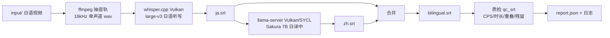

# 00 · 项目方案：日语视频本地 AI 字幕生成（日 → 中）

> 版本 v1.0 · 2026-11-15 · 状态：方案定稿，脚本与模型准备中
> 适用机器：Windows 11 + Intel Arc A770 16GB + Ryzen 7 7840H + 32GB RAM（**无 NVIDIA CUDA**）
> 本文件只写「做什么、为什么这么做、怎么验收」；逐步操作见 `01-部署手册-Windows.md`。

---

## 1. 目标与范围

### 1.1 一句话目标

把**日语对白的视频文件**，自动产出**时间轴准确、译文可用的中日双语 SRT**；全程本地离线，不给视频内容出本机；一台无 CUDA 的 Intel 平台机器上批量可跑。

### 1.2 交付物（验收对象）

| 交付物 | 位置 | 说明 |
|---|---|---|
| 双语字幕 | `output/<视频名>/bilingual.srt` | 中文在上、日文在下，同一条字幕两行 |
| 日语字幕 | `output/<视频名>/ja.srt` | 听写结果，可单独用于校对 |
| 中文字幕 | `output/<视频名>/zh.srt` | 纯中文，方便播放器/压制 |
| 质检报告 | `output/<视频名>/report.json` | 条数、CPS、超长、重叠、日文残留等 |
| 一键脚本 | `scripts/windows/run-all.ps1` | 插上硬盘 → 放视频进 `input/` → 跑一条命令 |
| 离线模型 | `models/` | Whisper large-v3 + Sakura/GalTransl 7B，随硬盘搬迁即用 |

### 1.3 明确不做的（范围外）

- 不做视频内嵌硬字幕压制（可选单独命令，但不在默认流水线里）。
- 不做人工精修 UI（需要精修时用 Transub / Subtitle Edit 等 GUI 工具，见 §4.3）。
- 不做语种识别以外的内容理解（不做摘要、不做说话人分离）。
- 不对翻译质量做「人工级润色」承诺；专训模型的目标是「能看懂、少错译」，不是出版级。

---

## 2. 硬件与硬约束

| 项 | 值 | 对方案的影响 |
|---|---|---|
| GPU | Intel Arc A770 16GB（Xe-HPG，XMX） | **无 CUDA**。可用后端只有 Vulkan / SYCL(oneAPI) / OpenVINO |
| CPU | Ryzen 7 7840H（8C16T） | CPU 只作退路；large-v3 在 CPU 上约为 GPU 的 1/5～1/10 速度 |
| 内存 | 32GB | 够用；长视频注意 whisper 一次性加载 wav 的内存占用 |
| 系统 | Windows 11 | 路径含中文/空格、PowerShell 执行策略、NTFS 盘符变化都要处理 |
| 介质 | 本机本地磁盘工作目录（2026-11-16 起）；移动硬盘仅作冷备份 | **全流程相对路径**，脚本用 `$PSScriptRoot` 定位项目根 |

**关键设计推论**

1. 选型必须只看「有没有 Vulkan/SYCL 后端」，不看 CUDA 生态。
2. 15GB 可用显存（扣除系统占用）足以放 whisper large-v3 + 7B 量化翻译模型，但**不要同时常驻**：先听写后翻译，分阶段跑，避免显存峰值与竞争。
3. 项目目录必须能「离线跑通」，因此工具二进制与模型都预先放在项目内，运行时不需要联网。

---

## 3. 方案总览



**为什么是这条链路（而不是现成 GUI 工具）**

| 需求 | GUI 工具（Transub/VoiceTransl） | 本方案（whisper.cpp + llama.cpp + 脚本） |
|---|---|---|
| 批量、无人值守 | 只能人工点，做不到定时/批量 | 一条命令跑完整个 `input/` |
| 断点重跑、失败重试 | 依赖软件自身 | 文件级跳过 + 重试日志 |
| 参数可控（VAD、提示词、CPS） | 界面固定 | 全在 `config/pipeline.json` |
| 适配 Intel Arc | 官方未声明支持 Intel（Transub 写的是 NVIDIA/AMD） | Vulkan/SYCL 后端原生覆盖 Intel |
| 结果可复现、可 diff | 黑盒 | 中间产物（wav/ja.srt/zh.srt）都在 `work/`、`output/` |

---

## 4. 工具选型结论（含对旧方案的纠正）

> 结论来自 2026-11-15 对官方仓库/Release 的实测核对，证据见 `docs/research/01-arc-toolchain.md`。
> **上一版规划里有两条关键断言经核实不成立，已推翻，不沿用。**

### 4.1 主路径（采用）

| 环节 | 选定工具 | 版本基线 | 理由 |
|---|---|---|---|
| 音频抽取 | ffmpeg（Windows 静态包） | 7.x | 事实标准，命令行稳定 |
| 日语听写 | **whisper.cpp（Vulkan 后端）** | 社区 Vulkan 构建 / 或目标机自编译 | whisper large-v3 日语质量最好；Vulkan 覆盖 Intel Arc；纯 C++ 无 Python 依赖 |
| 日译中 | **llama.cpp `llama-server`（Vulkan 或 SYCL）** + **Sakura-Galtransl / Hy-MT2 7B GGUF** | llama.cpp b12428（2026-11-16 实装） | 官方有 Windows Vulkan/SYCL 预编译；日译中专训 7B，幻觉少、语气自然 |
| 字幕合并/质检 | 本项目 Python 脚本 | 3.11+ 标准库 | 时间戳严格保真、质检可配置 |
| 编排 | PowerShell 脚本 | 5.1 / 7 均可 | Windows 原生，无需额外运行时 |

### 4.2 备选路径

| 场景 | 备选 | 说明 |
|---|---|---|
| 只想快速听写、懒得配 whisper.cpp | **babelscribe**（`pip install babelscribe`，MIT） | `babelscribe video.mp4 -f srt -l ja`，首次运行自动下载 Vulkan 版 whisper.cpp，官方声明支持 Intel Arc；缺点是要 Python 环境与首次联网 |
| 翻译模型想换更强的 | Sakura 14B GGUF | A770 16GB 可跑 Q4 级别；速度约为 7B 的 1/2 |
| 翻译想用云端 API | 任意 OpenAI 兼容端点 | 脚本只认 `/v1/chat/completions`，换 base_url 即可（注意隐私） |
| 完全不想写脚本 | **VoiceTransl** GUI（GPLv3，v1.31） | 一站式：下载→提音→听写→翻译→合成；声明支持 Intel GPU 加速。适合人工兜底 |

### 4.3 已淘汰/降级的工具（重要，避免返工）

| 工具 | 原设想 | 核实结果 | 结论 |
|---|---|---|---|
| **Transub v3.3.x** | 「有 CLI，`transub run --device intel-xpu`，原生支持 Arc」 | 官方 README：**仅 Windows**、Electron **GUI**、GPU 仅 NVIDIA(CUDA)/AMD(ROCm)，**没有 CLI 文档** | **不能作自动化主路径**。只在「需要 GUI 精修/质检/烧录」时人工使用（Arc 上大概率回落 CPU 慢跑） |
| whisper.cpp 官方 Windows 包 | 「官方有 Vulkan 预编译」 | 官方 Release 只有 CPU / CUDA / OpenCL-Adreno | Vulkan 版必须用**社区构建**或**自行编译**（部署手册给两条路） |

---

## 5. 工作流详述

### 阶段 0：一次性准备（在 macOS 准备机上完成，已完成大部分）

1. 建立目录骨架（`AGENTS.md` §4）。
2. 下载模型到 `models/` 并生成 `MANIFEST.md` + `CHECKSUMS.sha256`。
3. 准备 Windows 二进制放到 `tools/windows/`（ffmpeg、whisper-cli、llama-server 及 DLL）。
4. 写脚本与文档。

> 目标机首次使用只需：解压二进制 → 跑 `00-check-env.ps1` 自检 → 放视频 → `run-all.ps1`。

### 阶段 1：听写（视频 → 日语 SRT）

```
ffmpeg -i <video> -vn -ac 1 -ar 16000 -c:a pcm_s16le work/audio/<name>.wav
whisper-cli -m models/whisper/ggml-large-v3.bin \
            -f work/audio/<name>.wav \
            --language ja --vad -vm models/whisper/ggml-silero-v5.1.2.bin \
            -osrt -of output/<name>/ja -sns
```

要点：
- `--language ja` 必须显式给，否则会误判语种。
- `--vad` + Silero 能显著减少静音段的幻觉（「ご視聴ありがとうございました」这类）。
- `-sns`（suppress non-speech）抑制音乐/音效被转成文字。
- 首个任务的输出必须人工抽听 30 秒，确认时间轴与文本对得上，再批量跑。

### 阶段 2：翻译（日语 SRT → 中文 SRT）

```
llama-server -m models/translation/Sakura-Galtransl-7B-v3.7.gguf \
             --host 127.0.0.1 --port 8080 -c 4096 -ngl 99
```

- 逐条 POST `/v1/chat/completions`，system prompt 用 Sakura 官方推荐模板（见 `02-工作流与参数.md`）。
- 上下文：把前 2～3 条日中对照拼进 prompt，降低「这条在说什么」的误译。
- 失败句回退原文并记录到 `report.json`，不中断整批。
- 术语表：`config/term_map.json` 做人物名/专有名词强制替换。

### 阶段 3：合并与质检

- 合并规则：中文行 + 换行 + 日文行，共享同一时间轴（不改变起止时间）。
- 质检项：单条 CPS 上限（默认 18 字/秒）、单条时长上限（默认 7s）、相邻重叠、空行、**日文假名残留**（说明有句子没译）、条数与 ja.srt 对比（防丢句）。
- 输出 `report.json`；超过阈值只警告不阻断（由人决定是否回改）。

### 阶段 4：人工抽检（必须）

- 抽 3 段：开头 1 分钟、中间 1 分钟、结尾 1 分钟。
- 检查：时间轴是否抖动、译文是否「像中文」、人名是否统一、是否有整句漏译。
- 不通过 → 调 `02-工作流与参数.md` 里的参数重跑该视频（脚本支持单文件重跑）。

---

## 6. 目录与产物规范

```
input/                    用户放视频（支持 mp4/mkv/avi/mov/ts/webm）
work/audio/<name>.wav     中间音频（可删）
output/<name>/ja.srt      日语
output/<name>/zh.srt      中文
output/<name>/bilingual.srt 双语（最终产物）
output/<name>/report.json 质检
logs/run-YYYYmmdd-HHMMSS.log 运行日志
config/pipeline.json      实际参数（从 .example 复制）
```

命名规则：`<name>` = 视频文件名去扩展名，**不改名、不转写字符**，避免与源文件对不上号。

---

## 7. 参数基线（初始值，允许按片源调整）

| 参数 | 默认 | 说明 |
|---|---|---|
| 采样率/声道 | 16kHz / 单声道 | whisper 要求；降低体积与解码开销 |
| whisper 模型 | large-v3 | 日语首选；turbo 作对照 |
| beam size | 5 | 质量优先；赶时间改 1 |
| VAD | 开 | 静音段幻觉的主要抑制手段 |
| 翻译模型 | Sakura-GalTransl 7B Q6_K | 日译中专训，质量/速度平衡 |
| temperature / top_p | 0.3 / 0.8（以 Sakura 官方为准） | 翻译要稳定，不宜发散 |
| 并发 | 1（本地 7B 单卡） | 并发只会互相抢显存 |
| CPS 上限 | 18 | 中文阅读速度上限，超了要断句 |
| 双语布局 | zh_top | 中文在上、日文在下 |

---

## 8. 里程碑

| # | 里程碑 | 产出 | 状态 |
|---|---|---|---|
| M0 | 方案与选型定稿 | `AGENTS.md`、本文件 | ✅ 2026-11-15 |
| M1 | 模型就绪 | `models/`（large-v3 + VAD + 7B 翻译）+ 清单/校验和 | 🔄 进行中 |
| M2 | 脚本就绪 | `scripts/windows/*.ps1` + `scripts/python/*` + selftest 全绿 | 🔄 进行中 |
| M3 | 文档就绪 | `docs/01`～`docs/04` | ⏳ 待开始 |
| M4 | 目标机首次跑通（单视频） | 一份双语 SRT + 实测耗时/显存记录 | ⏳ 需在 Arc 机器上做 |
| M5 | 批量验收 | 3 个不同片源各 1 集，抽检通过 | ⏳ 依赖 M4 |

---

## 9. 验收标准（可测、不含「应该可以」）

**必须全部满足**

1. `00-check-env.ps1` 在目标机输出全 PASS（或明确列出缺失项与修复指令），退出码 0。
2. `run-all.ps1` 对 1 个 20～25 分钟日语视频，一次跑完不人工干预，退出码 0。
3. `bilingual.srt` 用播放器（PotPlayer / VLC）加载：字幕与语音**整体不漂移**（结尾处偏差 ≤ 0.5s）。
4. 条数守恒：`zh.srt` 条数 == `ja.srt` 条数（或 `report.json` 明确记录丢句数并给出原因）。
5. 抽检 3 段共 3 分钟：**错译/漏译率 < 20%**（人工粗判，能看懂剧情为准）。
6. 全程显存峰值 < 15GB，不出现 OOM；日志中能看到 Vulkan 设备被使用。
7. 断点能力：删掉 `zh.srt` 后重跑，跳过听写、只重跑翻译。

**性能目标（估算，需 M4 实测回填）**

| 环节 | 1 小时日语视频预期 | 依据 |
|---|---|---|
| 听写（large-v3 Vulkan） | 6～20 分钟 | 待实测；取决于 Vulkan 后端效率 |
| 翻译（7B Q6_K，约 800～1000 条） | 10～30 分钟 | 待实测 |
| 合计 | 约 20～50 分钟/小时视频 | 待实测回填 |

---

## 10. 风险与对策

| 风险 | 影响 | 对策 |
|---|---|---|
| whisper.cpp 社区 Vulkan 包版本旧/缺 DLL | 听写完全跑不起来 | 部署手册给「自编译 Vulkan 版」备选；再退到 CPU 版（慢但能跑） |
| Arc 驱动对 Vulkan 支持不稳（大显存分配失败） | 崩溃/回落到 CPU | 先跑 5 分钟短片验证；必要时换 SYCL 版 llama.cpp + OpenVINO 听写 |
| 移动硬盘 NTFS + 中文/空格路径 | 脚本参数被拆 | 脚本全量加引号；文档要求视频文件名尽量用 ASCII |
| 翻译模型幻觉（把日语原样吐回/中英混杂） | 字幕不可用 | system prompt 约束 + 假名残留质检 + 失败句回退重试 |
| 显存不足（large-v3 + 7B 同时常驻） | OOM | 强制分阶段：听写完再起 llama-server；跑完即停 |
| 目标机杀软拦截未签名 exe | 工具无法执行 | 文档给出加白名单步骤；不用安装器，纯绿色解压 |
| 准备机与目标机环境差异导致「文档能跑、实机不行」 | 返工 | 所有未实机验证项在文档里显式标注；M4 必须实机回填 |

---

## 11. 成本与授权

| 项 | 成本 | 许可 |
|---|---|---|
| whisper.cpp | 0 | MIT |
| llama.cpp | 0 | MIT |
| Whisper large-v3 权重 | 0 | MIT（OpenAI 发布） |
| Sakura / GalTransl 7B 权重 | 0 | 见 `models/MANIFEST.md` 记录的仓库 License（CC-BY-NC-SA 类，仅个人非商用） |
| ffmpeg | 0 | LGPL/GPL 视构建而定 |
| Transub / VoiceTransl（可选 GUI） | 0（Transub 部分功能付费） | Transub 非开源许可；VoiceTransl GPLv3 |

> 版权提醒：仅处理自己有权使用的视频；字幕产物不用于商业发行。

---

## 12. 后续可扩展（不在本期）

1. 硬字幕烧录（ffmpeg `subtitles=` 滤镜，需把字体与 libass 一起带）。
2. 术语表 + 人物名一致性词典（`config/term_map.json` 已预留）。
3. 整片上下文润色（把全片剧情摘要作为 prompt 前缀，降低前后不一致）。
4. 说话人分离（pyannote / Demucs）用于多人对白标注。
5. 字幕质量评分自动挑出「必须人工复核」的视频。

---

## 附：相关文档

- [AGENTS.md](../AGENTS.md) —— 给 Agent 的硬性约定
- [01-部署手册-Windows.md](01-部署手册-Windows.md) —— 目标机一步步操作
- [02-工作流与参数.md](02-工作流与参数.md) —— 参数怎么调
- [03-模型与工具清单.md](03-模型与工具清单.md) —— 下载了什么、从哪来
- [04-排错手册.md](04-排错手册.md) —— 按症状查
- [research/01-arc-toolchain.md](research/01-arc-toolchain.md) —— 选型核实证据
